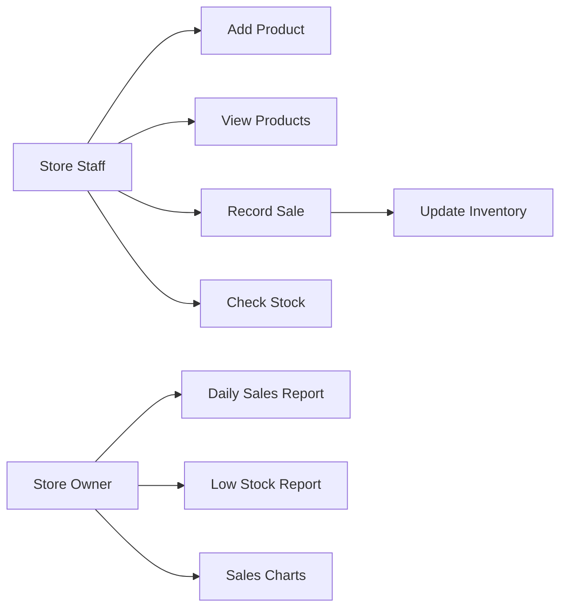
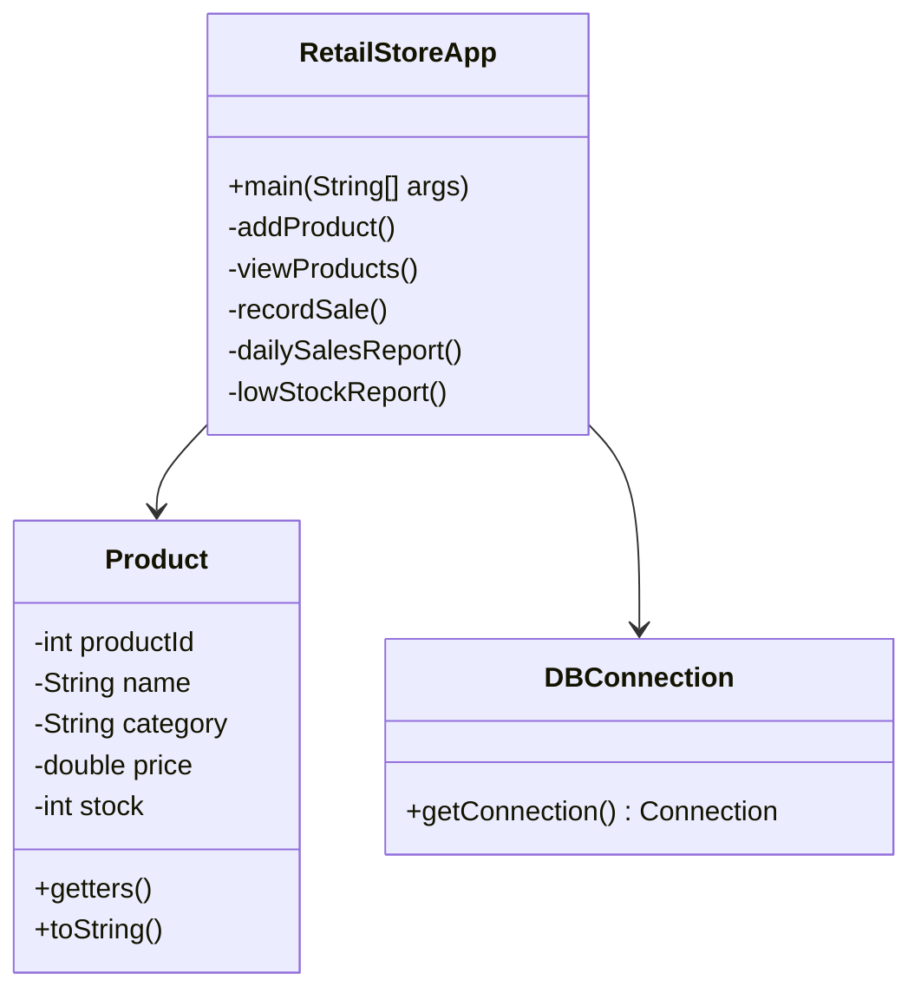
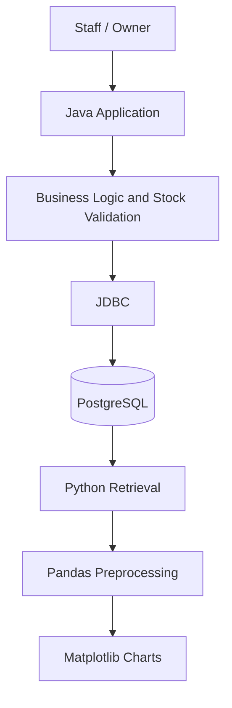
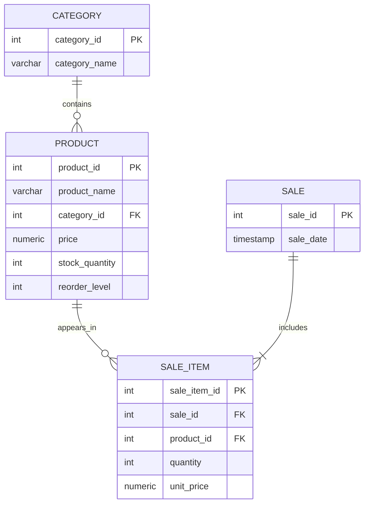

# SYSTEM DESIGN DIAGRAMS

Paste these Mermaid diagrams into Mermaid Live Editor or a compatible Markdown viewer.

## Use Case Diagram

## Class Diagram

## System Architecture

## ER Diagram

## Relational Model
- CATEGORY(**category_id**, category_name)
- PRODUCT(**product_id**, product_name, category_id FK, price, stock_quantity, reorder_level)
- SALE(**sale_id**, sale_date)
- SALE_ITEM(**sale_item_id**, sale_id FK, product_id FK, quantity, unit_price)

PK = Primary Key; FK = Foreign Key.
